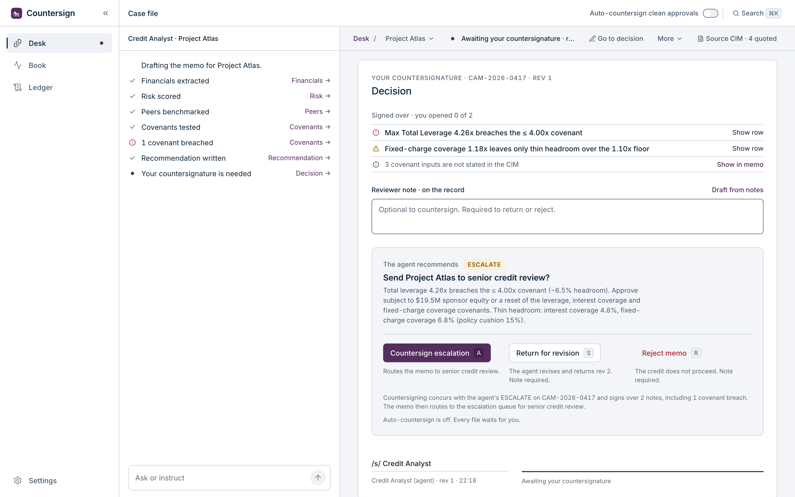
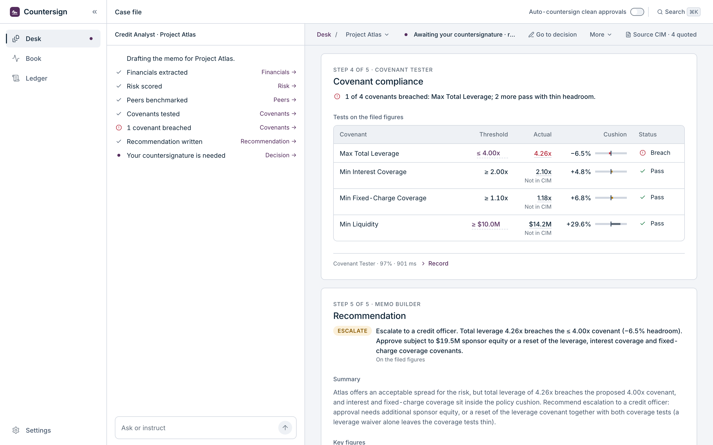
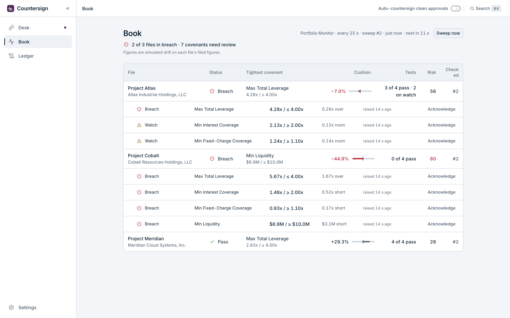
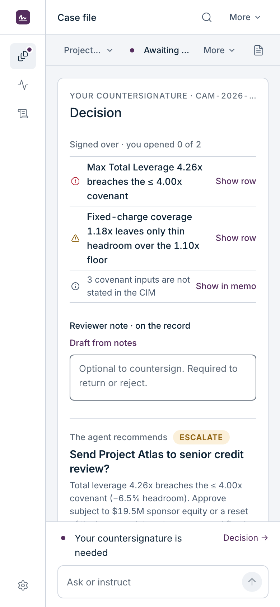

# Countersign — an agentic credit-analysis prototype

> **Countersign** (n.): the second signature that makes a document binding.
> The agent analyzes; a human countersigns. That's the whole product thesis.

**▶ Live demo: [credit-analysis-agent.vercel.app](https://credit-analysis-agent.vercel.app)** &nbsp;·&nbsp; auto-deployed from `main` via Vercel
**This branch is V2.** The original V1 stays one click away at `/?v=1`.

Countersign is a **front-end research prototype** exploring how an autonomous
credit-analysis agent can expose its evidence, route uncertainty, pause for accountable
human judgment, and preserve an auditable decision trail. There is **no backend**: the
"LLM" and its "tools" are mocked with async generators and timers, so it runs with zero
API keys and every run is reproducible. The subject is the *agentic UX and control flow*,
not the model.

> **The thesis:** in regulated decisions, an agent that is 80% accurate is a liability
> unless a human can see exactly what it did and refuse it. So the loop is built to be
> legible and interruptible rather than merely fast.



<sub>Atlas at the countersignature. Left: the agent panel, command and control only. Right: the memo's Decision card. The agent's call, its specific reasons, and three verbs, each with the consequence it will have.</sub>

---

## What V2 is

V2 is a full UI rebuild around one idea: **the credit memo is the product.** A credit
committee signs a memo, not an agent's log. So the agent's work arrives as a document you
read top to bottom, and the decision sits at its foot, where a reviewer would sign it.

- **Desk** (`#/`): the files you owe a decision on, grouped by what you owe. Select a
  project or drop in a CIM (extraction is simulated from the file name).
- **Case file** (`#/file/<id>`): three panes: navigation | agent panel | memo.
  - **The agent panel is command and control only**, like Claude Code: one-line status
    lines that point into the memo ("1 covenant breached · Covenants →"), the plan as a
    message, and the composer. It never displays data and never holds the decision.
  - **The memo writes itself live.** Before drafting it's just a header. Each section
    card appears when its step starts and fills in when the step returns: Financials →
    Risk → Peers → Covenants → Recommendation. Then comes the **Decision card**.
- **Book** (`#/book`): a portfolio monitor re-tests every file's covenants on a sweep.
  A breach can only be acknowledged with a written reason.
- **Ledger** (`#/ledger`): the decision record: every run, every reviewer action and
  every question asked, exportable as JSON.

| The memo: evidence on every figure | The Book: monitoring after a sweep | Phone: stacked |
|---|---|---|
|  |  |  |

---

## Key design decisions

Each of these came out of a specific problem, and each one is written down in
[`docs/v2/THREE-PANE.md`](docs/v2/THREE-PANE.md) and `CLAUDE.md`.

1. **One place to look for content, one place to steer.** Everything you read or decide is
   on the right, and the panel only reports and takes instructions. Splitting content
   across two panes made reviewers ask "do I look at the middle or the right?"
2. **The decision is stated where it's made.** The Decision card says "The agent recommends
   ESCALATE", asks the question, gives the decision rule's own reasons with sizes, and puts
   three verbs in one row (*Countersign*, *Return for revision*, *Reject*), each with its
   consequence underneath. After you act, the same card becomes the sealed record.
3. **No single keystroke can refuse a memo.** Return and Reject *arm* on the first press:
   the note field asks the verb's own question ("Why reject it?"), and only a second,
   deliberate press commits. Countersigning stays one click, as signing should be.
4. **Evidence on every figure.** Each number carries its provenance: *Quoted · CIM para 2*,
   *Derived 96.3 ÷ 22.6*, or *Not in CIM* when the figure came from the extraction model.
   The Decision card lists what you are signing over, including inputs the CIM never states.
5. **Live drafting, without a reasoning dump.** Cards appear as the agent works and the pane
   follows the card being written, until you scroll. When the analysis finishes, the memo
   lands on the Decision card. The agent's reasoning stays one click away in each card's
   *Record*, not streamed across the page.
6. **Automation you can see.** Auto-countersign handles only clean approvals (APPROVE, no
   flags, first pass, every key figure at 90% or above), always through a visible 5-second
   countdown you can hold. It resets on every page load, and its rule is stated next to
   the switch.
7. **Status is the loudest colour on the page.** Approve / escalate / decline use green /
   amber / red, and the accent (aubergine) is deliberately *less* colourful than all three,
   so the action colour never competes with a risk signal. Inter only, weights 400/500/600,
   a 4px grid, hairline borders, no drop shadows.
8. **It works at any width.** Below 900px the case file stacks: the memo goes full width,
   with the agent panel docked underneath as a strip (latest status line + composer).

## The decision rule (shared by V1 and V2)

The recommendation is computed, never hard-coded. It triages by **severity, not by counting
breaches**. The first rule that matches wins (constants in `src/agent/policy.ts`, rule in
`src/agent/whatif.ts`):

| | Condition | Call |
|---|---|---|
| 1 | Any key tool read below **75%** confidence | **ESCALATE**: verify the extracted figures |
| 2 | Risk score ≥ **75**, fixed-charge coverage < **1.00x**, leverage > **6.0x**, or a breach with no cure within policy | **DECLINE**, with up to four specific reasons |
| 3 | A breach that sponsor equity could cure, any covenant under **15%** headroom, or risk score ≥ **60** | **ESCALATE**: "approve subject to $X sponsor equity or a covenant reset" |
| 4 | Otherwise | **APPROVE** |

The three sample deals land on all three outcomes. Meridian approves. Atlas escalates with
a **$19.5M** cure; a send-back produces a revision that approves at 3.40x leverage. Cobalt
declines: risk score 82, fixed-charge coverage 0.95x, and four breaches with no cure.

---

## Run it

```bash
npm install
npm run dev        # http://localhost:5173  → V2   ·  /?v=1 → V1  ·  /?kit → V2 component kit
npm run build      # type-check (tsc --noEmit) + production build
npm run preview    # serve the build
```

On the Desk, press **Select** on a project, then **Start drafting**. A run takes about
10 to 13 seconds.

## Quality checks

Two automated checks guard V2, and both run locally:

```bash
npm run v2-check   # 28 source guardrails: tokens only, type roles, 4px grid, kit-only
                   # controls, one infinite animation, engine files untouched, …
npm run v2-visual  # Playwright + axe: 10 states × phone / tablet / desktop
                   # (serious accessibility violations, sideways overflow, cut-off
                   # elements, a usable memo pane and Decision card width)
```

The component kit is a closed set of primitives, and every one is shown on the kit page
(`/?kit`). Any new visual pattern is logged in `src/v2/design-pending.ts` for owner
approval. The design was researched against real products (Mobbin) and published design
systems ([awesome-design-md](https://github.com/VoltAgent/awesome-design-md)), then each
batch of changes went through adversarial review before it shipped.

---

## Architecture

The whole app is a **reducer over a typed event stream**. That one idea is the spine, and
both V1 and V2 are pure reductions of it:

```
runCreditAgent()  ──AsyncGenerator<AgentEvent>──►  useCreditAgent (reduce)  ──►  UI
   (the loop)                                          (React state)           (dumb views)
```

- **`src/agent/runAgent.ts`: the loop.** One `async function*`: plan → stream reasoning →
  call a tool → observe → derive flags (the *decide* step) → assemble the package →
  **human gate**. It never imports React. A real LLM backend would emit the same events.
- **Human-in-the-loop is a suspended generator, not a modal.**

  ```ts
  const decisionPromise = ctx.requestApproval(); // registers a resolver
  yield { type: 'awaiting_approval', package };   // UI renders the gate
  const decision = await decisionPromise;         // ← the loop is parked here
  ```

  The `await` literally pauses the agent until a person acts. No polling, no flags.
- **V2 layering** (`src/v2/`):
  - `kit/` is the closed primitive set, and the only place component CSS lives.
  - `model/` is the single source of every derived number, label and sentence.
  - `state/` holds the store, gate and orchestration, and is the only place browser
    storage is touched.
  - `screens/` is `desk`, `file`, `chat`, `decision`, `book`, `ledger` and `settings`.
  - Screens render model views verbatim and call store actions; they never compute.

```
src/
  agent/        the shared engine: types.ts (the AgentEvent contract), runAgent.ts (the loop),
                tools.ts, policy.ts + whatif.ts (the decision rule), monitor.ts, responder.ts
  hooks/        useCreditAgent.ts, useMonitor.ts: generator → reduce → state + controls
  v2/           kit/ · model/ · state/ · screens/ · chrome/ · KitPage.tsx
  components/   V1's views (served at /?v=1)
scripts/        v2-check.sh, v2-visual.mjs
docs/v2/        SPEC.md (the build spec), THREE-PANE.md (the case file and its revisions)
```

### Extension points

Each of these is small *because* of the event-stream design:

- **Add a tool or step**: a `ToolName`, a `TOOLS` entry and one plan row. V1 renders it as
  is; V2's agent panel gets its status line at once, and its memo needs one section view.
- **Stream real tokens**: swap the mocked stream for `fetch()` + SSE. The reducer doesn't
  change, because the events don't.
- **Change house policy**: edit the constants in `src/agent/policy.ts`. The memo, the
  Decision card's reasons, the stress test's flip zones and the cure search all follow,
  because they share one `decide` function.

---

## V1 (kept at `/?v=1`)

V1 is the original prototype. Its main canvas is the agent's process: streaming reasoning,
inspectable tool calls, an approval gate with *amend terms*, and a live **what-if panel**
whose flip zones show which change would move the recommendation. It has light and dark
themes in the "Graphite & Teal" design system, catalogued at
[/designsystem](https://credit-analysis-agent.vercel.app/designsystem). It shares V2's
engine and decision rule.

---

_A research prototype. The backend is mocked and all deal data is fictional._
